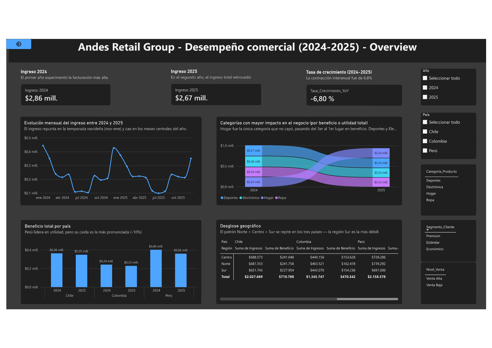
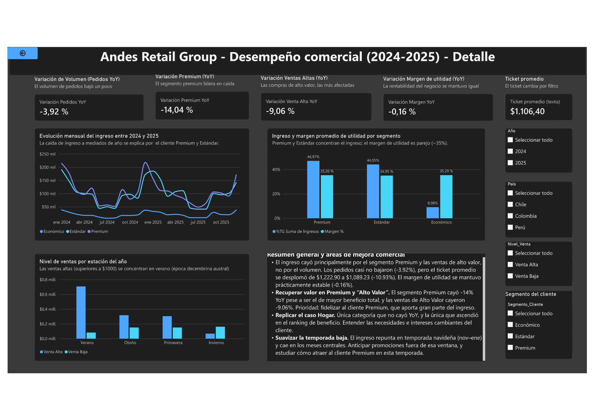
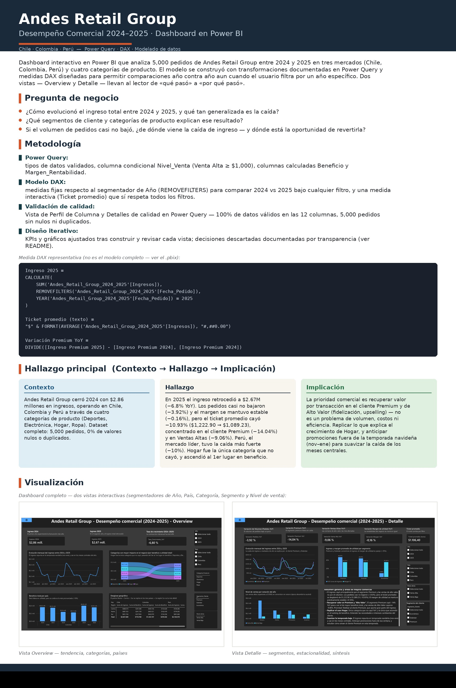

# Andes Retail Group — Commercial Performance Dashboard (2024–2025)

Why did revenue fall when the order count barely moved? · Power BI · Power Query · DAX

[](https://app.powerbi.com/view?r=REPLACE_WITH_PUBLISH_TO_WEB_LINK)
[-1A2A3A?style=for-the-badge&logo=googledrive&logoColor=white)](assets/Infographic_AndesRetail_ES.jpg)
[](powerbi/Proyecto_Power_BI_Andes_Retail_Group.pbix)

## 📸 Dashboard

<table>
<tr>
<td width="50%" valign="top">

**Vista Overview** — tendencia, categorías, países



</td>
<td width="50%" valign="top">

**Vista Detalle** — segmentos, estacionalidad, síntesis



</td>
</tr>
</table>

<details>
<summary>📊 Ver la infografía completa del proyecto</summary>
<br>



</details>

## 🔍 Overview

An interactive Power BI dashboard analyzing 5,000 orders placed by Andes Retail Group across three markets (Chile, Colombia, Perú) and four product categories between 2024 and 2025. The data was cleaned and shaped in Power Query, then modeled with DAX measures built specifically to compare 2024 against 2025 under any filter state — a card showing "Revenue 2024" stays fixed at the full-year figure even when the user filters the page by country or segment.

The dashboard is built as two views with a deliberate escalation: an **Overview** that answers *what happened* at the company level, and a **Detail** view that decomposes the *why* behind it. Revenue fell 6.8% year over year ($2.86M → $2.67M), but the order count barely moved (−3.92%) and margin stayed essentially flat (−0.16%). The real driver is average ticket, which dropped 10.93%, concentrated almost entirely in the Premium customer segment (−14.04%) and in high-value orders (−9.06%) — the segment that generates the most profit for the business. Home goods was the only product category that grew, climbing from 3rd to 1st place in profit.

Design decisions that were tried and discarded during construction are documented below for process transparency, rather than hidden once the final version shipped.

## 🎯 Problem Statement

**Business Question:** Why did Andes Retail Group's revenue fall in 2025, and where is the commercial opportunity to recover it?

A retail group operating in three Latin American markets needed to understand a year-over-year revenue contraction and decide where to focus commercial effort — without knowing in advance whether the cause was volume, pricing, a specific segment, or a specific market.

Supporting questions:

- How did total revenue evolve between 2024 and 2025, and how widespread is the decline across countries?
- Which customer segments and product categories contribute the most revenue and profit?
- Which product categories have the greatest impact on the business, by profit rather than just revenue?
- Are there meaningful differences between countries or regions?
- What seasonal patterns show up across the year?
- If order volume barely declined, where exactly is the revenue loss coming from — and where is the opportunity to recover it?

## 💡 What I Did

**Power Query — data preparation.** Validated data types across all 12 columns; standardized the date format to Latin American Spanish; converted `Ingresos`, `Costo`, and the new `Beneficio` column to currency format. Built a conditional column `Nivel_Venta` (Venta Alta / Venta Baja, threshold ≥ $1,000) and calculated columns `Beneficio` (`Ingresos − Costo`) and `Margen_Rentabilidad`. Column Profiling, Column Quality, and Column Distribution views were enabled to validate data quality — all 12 columns returned 100% valid values across the 5,000 rows, with zero nulls and zero duplicates.

**DAX measures — comparable year-over-year KPIs.** Built fixed-year measures (`Ingreso 2024`, `Ingreso 2025`, and their YoY variants) using `REMOVEFILTERS` on the date column, so the Overview cards stay comparable even when a user filters by country or product. Built one deliberately *interactive* measure — `Ticket promedio` — that does respect every filter, serving as a free-exploration tool alongside the fixed year-over-year comparisons.

**Vista Overview — the company-level picture.** Three executive KPI cards (Revenue 2024, Revenue 2025, YoY Growth Rate) answer the anchor question directly: both the absolute size of the business and the direction of change, because a change rate alone doesn't communicate magnitude. A monthly revenue line shows the recurring seasonal pattern (a December-season peak, a mid-year trough). A **Sankey/alluvial diagram** — chosen over grouped bars because the finding is a *ranking change*, not a magnitude difference — shows Home goods climbing from 4th to 1st in profit while Sports and Electronics fall. A grouped bar chart plus a geographic breakdown table expose a consistent North > Center > South pattern repeating across all three countries.

**Vista Detalle — decomposing the "why."** Five diagnostic KPI cards isolate the explanatory variables: order-volume change, margin change, Premium-segment change, high-value-sales change, and an interactive average-ticket card. Together they build the explanatory equation: orders barely fell (−3.92%) and margin held (−0.16%), so the revenue drop is a **value-per-transaction** problem, not a volume or efficiency problem. A monthly line broken out by customer segment shows the mid-year dip concentrated in Premium and Estándar. A grouped bar chart of revenue share and margin by segment shows margin is nearly identical across all three segments (~35%) — the difference between segments is volume, not profitability. A column chart of sales level by season shows high-value sales concentrated in the Southern Hemisphere summer (Nov–Jan). A text-synthesis panel converts the quantitative findings into three ranked, actionable commercial opportunities rather than leaving that inference to the reader.

**Narrative, in two formats.** The findings are written up twice for two different audiences: an SCQA-structured narrative (Situation–Complication–Question–Answer) for a detailed read, and a condensed async Slack-style update for a team that needs the headline in under a minute. Both are reproduced in full below.

## 🛠️ Technologies Used

| Category | Tools |
|---|---|
| Data preparation | Power Query (M) — type validation, conditional columns, calculated columns, data-quality profiling |
| Modeling | Power BI data model, DAX (`CALCULATE`, `REMOVEFILTERS`, `DIVIDE`, `FORMAT`, `DISTINCTCOUNT`) |
| Visualization | Power BI Desktop — line, grouped bar, Sankey/alluvial, column charts, matrix table, card visuals, slicers |
| Techniques | Year-over-year comparison under active filters, conditional columns, calculated-column vs. measure trade-offs, data-quality validation, narrative synthesis (SCQA) |
| Environment | Power BI Desktop |

## 📊 Key Findings

| Result | Measure | Value | Read |
|---|---|---|---|
| Total revenue, YoY | `Tasa_Crecimiento_YoY` | −6.8% | $2.86M (2024) → $2.67M (2025) |
| Order volume, YoY | `Variación Pedidos YoY` | −3.92% | Volume barely moved — not a demand problem |
| Margin, YoY | `Variación Margen YoY` | −0.16% | Effectively flat — not an efficiency problem |
| Average ticket, YoY | computed from `Ingresos` / orders | −10.93% | $1,222.90 → $1,089.23 — this is where the revenue went |
| Premium segment revenue, YoY | `Variación Premium YoY` | −14.04% | Steepest drop of any single cut in the data, in the segment with the highest profit share |
| High-value sales, YoY | `Variación Venta Alta YoY` | −9.06% | Orders ≥ $1,000 fell faster than order volume overall |
| Revenue and margin by segment | grouped bar, Vista Detalle | Premium 46.97% rev / 35.20% margin · Estándar 44.05% / 34.95% · Económico 8.98% / 35.29% | Margin is ~35% across all three segments — the gap between them is volume, not profitability |
| Profit by country, YoY | grouped bar, Vista Overview | Perú −10% · Colombia −4.2% · Chile −2.8% | Perú, the leading market by profit, also has the steepest decline |
| Profit by category, YoY | Sankey diagram | Hogar 3rd → 1st; Deportes and Electrónica fall | Home goods is the only category that grew, and the only one that climbed in rank |
| Geographic pattern | matrix table, both views | North > Center > South in every country | A transversal, structural pattern rather than an isolated country issue |
| Seasonality | column chart, Vista Detalle | High-value sales concentrated in Verano (Nov–Jan) | Revenue repeats a predictable seasonal shape every year |

### Context → Findings → Implications (C→F→I)

**📍 Context:** Andes Retail Group closed 2024 with $2.86 million in revenue across three markets (Chile, Colombia, Perú) and four product categories (Deportes, Electrónica, Hogar, Ropa). The dataset is complete — 5,000 orders, zero nulls, zero duplicates, 100% valid values across all 12 columns.

**🔍 Findings:**
- Revenue fell 6.8% year over year ($2.86M → $2.67M), and the decline repeats the same North > Center > South pattern inside all three countries.
- The order count barely moved (−3.92%) and margin stayed essentially flat (−0.16%) — so the drop is not a volume or efficiency problem.
- What actually fell is the average ticket: −10.93%, from $1,222.90 to $1,089.23.
- That ticket drop concentrates almost entirely in two cuts of the data: the Premium customer segment (−14.04% YoY) and high-value orders ≥ $1,000 (−9.06% YoY) — despite Premium being the segment with the highest profit contribution.
- Margin is nearly identical across all three customer segments (~35%), which rules out a pricing or cost-structure explanation and confirms the gap between segments is about purchase volume, not profitability.
- Perú, the market with the highest total profit, also posted the steepest year-over-year decline (−10%, vs. −2.8% Chile and −4.2% Colombia).
- Hogar is the only product category that did not fall, climbing from 3rd to 1st place in profit while Deportes and Electrónica — the two strongest categories in 2024 — both retreated.
- High-value sales concentrate predictably in the Southern Hemisphere summer (Nov–Jan); the mid-year months are a recurring trough.

**💡 Implications:**
- ✅ **Treat this as a value-per-transaction problem, not a volume problem.** Orders held; the business is losing how much each order is worth, concentrated in its most valuable customers.
- 🎯 **Prioritize Premium-segment retention and upselling.** A −14.04% drop in the segment that contributes the most profit is the single largest lever available, and it has nothing to do with the company's cost base or pricing — margin there is unchanged.
- 🔄 **Investigate what Hogar is doing differently and replicate it.** It is the only category that grew and the only one that climbed in the profit ranking during a year every other category fell.
- 📋 **Treat Perú as a priority market for diagnosis, not just as the top performer.** Being the largest market and having the steepest decline are not contradictory — they make it the highest-leverage place to intervene.
- 📊 **Plan commercial activity around the recurring seasonal shape.** High-value demand is predictable; promotions timed for the mid-year trough would target the months where ticket value is already structurally weaker.
- ⚠️ **Do not reach for a pricing or cost lever.** Margin held flat across years, countries and segments — the evidence does not support that diagnosis.

## 📝 Narrative (SCQA)

### 🖥️ Vista Overview

**S (Situation):** Andes Retail Group closed 2024 with $2.86 million in revenue, operating in three markets (Chile, Colombia, Perú) across four product categories (Deportes, Electrónica, Hogar, Ropa).

**C (Complication):** In 2025, total revenue fell to $2.67 million — a 6.8% year-over-year contraction. The decline is not uniform: Perú, the leading market by profit, posted the steepest drop (−10%) against Chile (−2.8%) and Colombia (−4.2%); and among categories, Deportes and Electrónica retreated sharply while Hogar was the only one to rise, climbing from 3rd to 1st in profit.

**Q (Question):** How widespread is this contraction, and is any part of the business compensating for the decline?

**A (Answer):** The contraction is partially widespread — all three countries fall, and the North > Center > South pattern repeats in each of them — but it is not uniform: Hogar emerges as the most resilient category of the period, and Perú concentrates most of the deterioration. This points to a cause that is not structural across the whole business, but concentrated in specific pockets — which the Detail view explains in depth.

### 🔎 Vista Detalle

**S (Situation):** The business maintains a healthy, stable profit margin (~35%), with only a −0.16% variation, despite the complications described below.

**C (Complication):** Decomposing the revenue drop from the Overview, order volume barely moved (−3.92%), but average ticket collapsed from $1,222.90 to $1,089.23 (−10.93%) — and that drop in value per transaction concentrates in the Premium segment (−14.04% YoY) and in high-value sales (−9.06% YoY), despite Premium being the segment with the highest total profit.

**Q (Question):** If the business didn't lose customers or large-scale performance, why did revenue fall, and where is the opportunity to reverse it?

**A (Answer):** The business didn't lose customers — it lost high value. Premium customers keep buying at nearly the same frequency, but they spend significantly less per purchase. The priority commercial opportunity is to **recover transaction value in the Premium/high-value segment** (retention, loyalty, upselling), not to adjust pricing or costs. As secondary levers: replicate whatever conditions made Hogar the only growing category, and anticipate promotions outside the Nov–Jan holiday season to smooth the recurring mid-year seasonality.

### 💬 Async message (Slack-style summary)

> **📊 Commercial performance update**
>
> Team, summary of what the 2024–2025 revenue analysis shows:
>
> Revenue fell 6.8% YoY ($2.86M → $2.67M), orders dropped only slightly (−3.92%), and margin held steady (~35%). The real decline is in average ticket: −10.93% ($1,222.90 → $1,089.23), concentrated in the Premium customer (−14% YoY) and in high-value sales (−9.06%) — exactly our highest-profit segment.
>
> Perú, our leading market, had the steepest drop (−10% vs. −2.8% Chile and −4.2% Colombia); and Electrónica, our strongest category, fell −11.28%, while Hogar was the only one to grow and climbed to 1st place in profit.
>
> Possible commercial opportunities:
> - **Priority #1:** retain and increase purchase value from the Premium customer (upselling, cross-selling) — this is a volume-per-customer issue, not a pricing or efficiency one.
> - **Priority #2:** understand what Hogar is doing right and replicate it across other categories.
> - **Priority #3:** anticipate promotions outside the holiday season (Nov–Jan) to smooth the mid-year dip.
>
> Full dashboard available for anyone who wants to dig into country, segment or category detail. 🙌

## 🚀 How to Use

```
andes-retail-performance-dashboard-powerbi/
├── powerbi/
│   └── Proyecto_Power_BI_Andes_Retail_Group.pbix
├── data/
│   ├── Andes_Retail_Group_2024_2025.csv
│   └── Andes_Retail_Group_2024_2025.xlsx
├── assets/
│   ├── Infographic_AndesRetail_ES.jpg
│   ├── dashboard_overview.png
│   └── dashboard_detalle.png
├── scripts/
│   └── make_infographic.py
├── LICENSE
└── README.md
```

- **Open the dashboard** — `powerbi/Proyecto_Power_BI_Andes_Retail_Group.pbix` in Power BI Desktop. The data source points to the CSV/XLSX in `data/`; if the path breaks after cloning, repoint it via *Transform Data → Data Source Settings*.
- **Explore without Power BI** — both dashboard views are exported as static images in `assets/`, and the full narrative is reproduced above.
- **Reuse the source data** — `data/` carries the same 5,000-row table in both CSV and XLSX; schema is documented below.
- **Regenerate the infographic** — `scripts/make_infographic.py` builds `assets/Infographic_AndesRetail_ES.jpg` from the dashboard exports with Pillow (`pip install pillow`).

### Dataset schema

| Column | Type | Description |
|---|---|---|
| `ID_Pedido` | integer | Unique order identifier |
| `Fecha_Pedido` | date | Date the order was placed |
| `Estación` | categorical | Southern Hemisphere season (Verano, Otoño, Invierno, Primavera) |
| `ID_Cliente` | categorical | Unique customer identifier |
| `Segmento_Cliente` | categorical | Customer tier — Económico, Estándar, Premium |
| `Región` | categorical | Geographic region within the country |
| `País` | categorical | Chile, Colombia, Perú |
| `Categoría_Producto` | categorical | Deportes, Electrónica, Hogar, Ropa |
| `Unidades_Vendidas` | integer | Units sold in the order |
| `Precio_Unitario` | decimal | Unit price |
| `Ingresos` | decimal | Order revenue (price × units) |
| `Costo` | decimal | Order cost |

Columns added in Power Query: `Beneficio` (`Ingresos − Costo`), `Margen_Rentabilidad` (`Beneficio / Ingresos`), `Nivel_Venta` (Venta Alta if `Ingresos` ≥ 1,000, else Venta Baja).

**Unit of analysis:** one row per order; 5,000 orders, Jan 2024 – Dec 2025.

## ⚖️ Limitations

- **Profitability segmentation was tried and dropped.** Splitting `Margen_Rentabilidad` into discrete bands (Low/Medium/High) was explored for faster reading, but margin turned out to be nearly homogeneous (~35%) across segments and regions within each country — a continuous KPI plus its YoY variation communicated that finding more faithfully, so the categorical version was discarded.
- **A `Margen_Rentabilidad` calculated column was replaced with a measure.** Computing it as a static column would have frozen it at row grain instead of recalculating correctly under aggregation and filters.
- **Two planned measures were cut from the final build.** `Estación_Líder` (season with highest profit) and `País_Líder_Nombre` (country with highest cumulative profit) were defined in the initial plan but dropped once the seasonal pattern and country breakdown were already communicated more clearly through existing charts — keeping the KPI row focused on variables that explain *why* revenue moved, not restating what the charts already show.
- **Card-visual currency formatting bug.** A known Power BI bug forces the new "Card" visual to auto-abbreviate numbers ("1 mil", "2K") even with currency/2-decimal formatting applied, and the "Display units = None" option does not work on this visual. Fixed only for the `Ticket promedio` measure by converting to text with `FORMAT()`; not resolved for the remaining numeric currency measures.
- **No formal statistical testing.** YoY and segment differences are reported as point percentages with no confidence intervals or significance tests — appropriate for an executive dashboard, but a claim like "Perú fell more than Chile" has not been tested for whether the gap exceeds normal variation.
- **Correlation between variables was not modeled.** The Premium-segment drop and the high-value-sales drop are reported side by side because they overlap heavily in practice, but the degree of overlap itself was not quantified.
- **Two years of data limits trend analysis.** The YoY comparisons rest on exactly two annual cycles; the seasonal pattern reads as consistent but has not been observed across a third year.
- **Causality is not established.** The dashboard identifies *where* the revenue drop concentrates (Premium, high-value, Perú) but not *why* those customers are spending less per order — that requires qualitative or behavioral data this dataset does not contain.

## 🧭 Next Steps

- **Quantify the overlap between Premium and high-value orders** — a cross-tab of `Segmento_Cliente` × `Nivel_Venta` would show how much of the −9.06% high-value decline is the same customers as the −14.04% Premium decline, versus two separate effects.
- **Add a cohort or retention view** for the Premium segment — distinguishing "Premium customers buying less per order" from "Premium customers churning entirely" requires tracking `ID_Cliente` over time, which the current views don't do.
- **Build a Perú-specific diagnostic page** — the current views cut by country as one of several slicers; given Perú carries the steepest decline, a dedicated page replicating the Detail view's logic filtered to Perú would surface whether the same Premium/high-value pattern explains it or whether a different driver is at play there.
- **Investigate the Hogar growth driver directly** — cut Hogar's orders by segment, region and season to test whether its growth is broad-based or concentrated, before recommending it as a template for other categories.
- **Statistical validation** — a simple test (e.g., a proportions or means comparison by year) on the headline YoY figures, to state whether the observed differences exceed what normal variation would produce.
- **Fix the remaining currency-format bug** — apply the same `FORMAT()` text workaround used for `Ticket promedio` to the other currency card visuals, or track the Power BI bug fix.

## 📚 Learnings & Best Practices

- **Fixed-year measures need `REMOVEFILTERS`, not just a hard-coded year filter.** Without it, filtering the page by country also filters "Revenue 2024" down to that country's figure, breaking the year-over-year comparison the card is meant to provide.
- **A calculated column and a measure are not interchangeable for a ratio.** `Margen_Rentabilidad` as a static column freezes at row grain; as a measure, it recalculates correctly as the user filters and aggregates — discovered by testing both and comparing behavior under filters.
- **Pick the chart for the shape of the finding, not habit.** A Sankey diagram communicated the Hogar ranking change at a glance in a way grouped bars could not — the finding was a *rank swap*, and the chart needed to show movement, not just magnitude.
- **Decide what *not* to build from what the data actually shows, not from the original plan.** `Estación_Líder` and the discrete margin bands were both planned and both cut — in both cases because, once built, the data showed the finding was better communicated another way (margin was too homogeneous to need bands; the seasonal leader was already clear from the existing chart's narrative subtitle).
- **Document the discarded decisions, not only the shipped ones.** A dashboard's final version hides every path that was tried and abandoned; writing those down is what makes the design defensible and lets the next iteration avoid re-testing the same dead end.
- **State what the dashboard cannot tell you.** "Revenue dropped in the Premium segment" is a finding; "and we don't yet know whether those are the same customers buying less or different customers leaving" is the boundary of that finding — both belong in the write-up.

---

**Author:** Max Santana — Data Analyst, Business Intelligence & Strategic Foresight · [GitHub](https://github.com/maxsantana-data2strategy) · [Portfolio](https://maxsantana-data2strategy.github.io)

**Status:** ✅ Complete | **Data Quality:** ✅ Validated (5,000 orders, zero nulls, zero duplicates, 100% valid values) | **Ready for Decisions:** ✅ Yes, with the stated validation caveats
